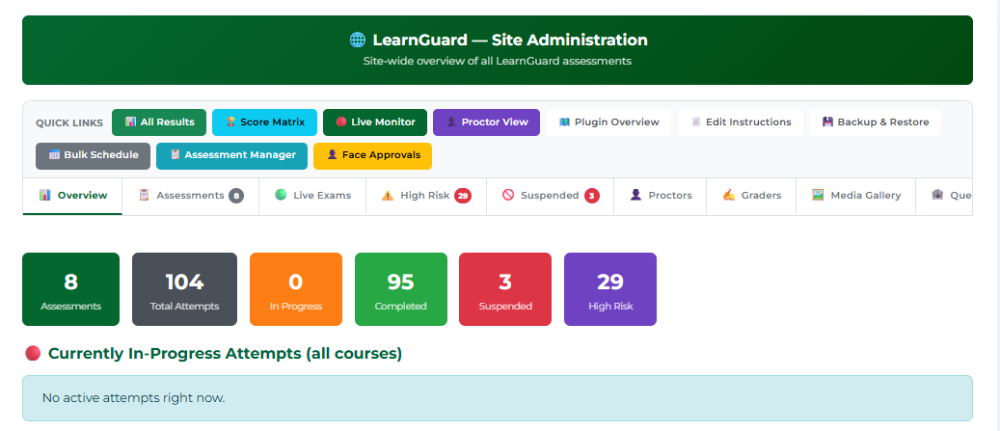
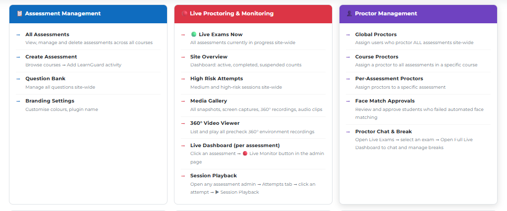
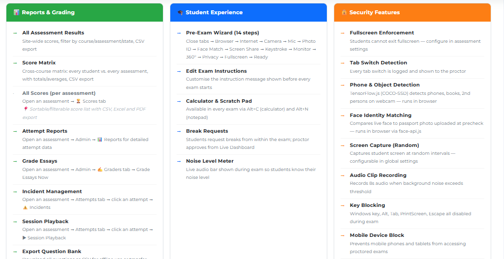
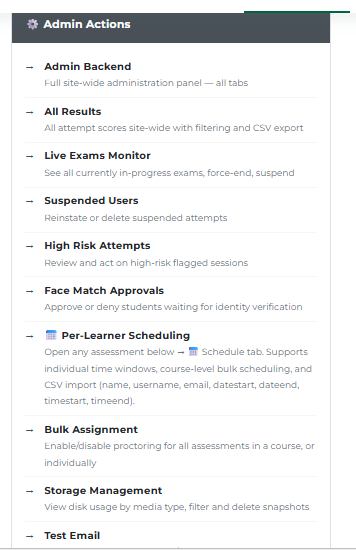
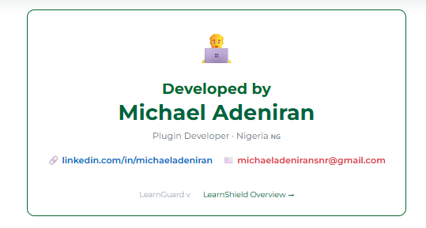

# LearnGuard

AI-powered exam proctoring for Moodle — a standalone assessment module with a built-in question bank, 14-step pre-exam wizard, live monitoring, intelligent violation detection, and full grading workflow.

Developed by **Michael Adeniran** · Nigeria 🇳🇬

  

---

## Overview

Moodle's built-in quiz offers basic assessment — but no proctoring, no identity verification, no live supervision, and no meaningful violation detection out of the box. LearnGuard fills that gap without any external services, Docker containers, or paid APIs.

Everything runs in the student's browser: face detection, liveness checks, face identity matching, object detection (phone, book, laptop), audio noise monitoring, and screen capture — all powered by face-api.js and YOLOv5n ONNX. A proctor watching the live dashboard sees snapshots, risk scores, and violation events in real time. Graders score essays and short answers through an anonymous grading interface. Admins see every attempt across every course in a single Score Matrix.

This repository contains two components that work together:

| Plugin | Component | What it does |
|---|---|---|
| `_lg_work/learnguard/` | `mod_learnguard` | The main plugin — standalone SPA assessment activity with question bank, pre-exam wizard, live proctoring, grading, and all admin/proctor tools |
| `_lg_work/block_learnguard/` | `block_learnguard` | Companion block showing assigned LearnGuard assessments and attempt status on the learner's Moodle dashboard |

---

## Features

### 🧭 Pre-Exam Wizard (14 steps)
- **Close Tabs → Browser → Internet → Camera → Microphone → Photo ID → Face Match → Screen Share → Keystroke → Monitor → Environment 360° → Privacy → Fullscreen → Ready**
- Scroll-gated checkboxes — learner must read to the bottom before Continue unlocks
- Photo ID upload (passport, employee card, staff ID) with automated face-api detection; falls back to invigilator review if detection is unavailable
- 360° environment recording with an explicit Upload button — Continue only enabled after server confirms the upload (no auto-advance)
- Privacy notice is admin-configurable; learner must scroll to bottom, tick the checkbox, then click Continue — no timers, no auto-advance
- Pre-exam summary step surfaces any flagged notes before the privacy step

### 🔒 Live Proctoring & Violation Detection
- **Face detection** (TinyFaceDetector) every second — configurable miss streak before logging
- **Liveness check** (blink detection via faceLandmark68Tiny)
- **Face identity matching** (faceRecognitionNet) against the uploaded photo ID, every 5 minutes during the exam
- **Object detection** (YOLOv5n ONNX in-browser): phones, books, laptops, keyboards, extra persons, multiple faces
- **Audio noise monitoring** — configurable threshold; sustained noise triggers an audio clip recording
- **Evidence capture** on every scored violation: webcam snapshot + screen capture + 5-second audio clip
- **Screenshots** every 15 seconds (periodic + random), configurable via admin settings
- **Key blocking**: Windows key, Alt, Tab, PrintScreen, Escape all disabled during the exam
- **Fullscreen enforcement** with overlay blocker; exam reloads and file dialogs do not trigger violation
- **Tab switch detection** — every switch logged and shown to the proctor
- **Mobile device block** — phones and tablets cannot access proctored assessments
- **Multiple monitor detection** — logged and toasted to the learner
- **Break requests** — student selects a duration, proctor approves from the live dashboard; exam timer freezes during the break with a live countdown overlay

### 📋 Question Bank & Assessment
- Six question types: **Essay, MCQ, Multi-select, Short Answer, True/False, Matching**
- Per-question default marks, case-sensitive matching for Short Answer
- Random question pools — draw N questions from a pool of M
- Rich text formatting toolbar on question and marking guide fields
- CSV / GIFT / Aiken import; export question bank
- Bulk mark change with automatic attempt recalculation

### 🖊️ Grading
- Anonymous Layer-1 / Layer-2 grading workflow — graders only see candidate numbers, not names
- Colour-coded question pills: green (full marks), yellow (partial), red (zero), blue (ungraded essay), red-gray (no response)
- Grade history popup showing every grader's submission with timestamp
- Per-attempt PDF export for print/archive
- **Auto-grading** for MCQ, Multi-select, True/False, Short Answer — graders can still override
- Essay **Marking Guide** field visible only to graders, not students
- Grader distribution modes: all graders / split / random / manual assignment
- Responses auto-saved every 5 seconds; current answer saved before timer-expiry submission

### 📊 Scores & Reporting
- **Score Matrix** — every student × every assessment, one row per student, grouped by course; sortable by name, total, average, recency; per-course Att# column and Last Completed date; CSV export
- **All Scores** page — sortable (name, attempt, state, score, risk, started, finished), filterable (state, risk level, name/email search); CSV, Excel, and PDF export
- **Attempt Reports** — full question-by-question detail per student with score breakdown
- **Session Playback** — replay a student's session from the attempt detail view
- Risk score sparkline trend in attempt detail
- Raw mark display (earned / slot total) alongside scaled grade

### 🛡️ Proctor & Admin Tools
- **Site Administration dashboard** — 8 assessments, 104 attempts, live counters for in-progress, completed, suspended, and high-risk; quick-link toolbar to every admin page
- **Live Monitor** — real-time grid of active exams, webcam toggle per-card or bulk, 15-second auto-refresh
- **High Risk Attempts** — filter and act on medium/high-risk sessions site-wide
- **Proctor Dashboard** — chat with students, approve/deny break requests, see live break countdown timers, view recently resumed students
- **Suspended Learners** — bulk reinstate or confirm suspension with flagged badges
- **Face Match Approvals** — review and approve students whose automated photo ID check failed
- **Per-Learner Scheduling** — assign each learner an individual time window per assessment (checkbox selection or CSV import with `name,username,email,datestart,dateend,timestart,timeend`); course-level bulk scheduling also available
- **Assessment Manager** — per-student overrides for window close date, extra attempts, and time limit; bulk reattempt grant (voids latest attempt, student can sit again)
- **Bulk Assignment** — enable or disable proctoring for all assessments in a course, or individually
- **Media Gallery** — all snapshots, screen captures, 360° environment recordings, and audio clips; filter by type, select and delete in bulk
- **Storage Management** — disk usage by media type with lazy-loaded byte totals; filter and delete
- **Incident Management** — auto-created on high-risk crossing; proctor-created manually; full audit trail
- **Global & Course Proctors** — assign users as proctors site-wide or scoped to a course; email notification on assignment

### 🎓 Student Experience
- Live noise meter bar showing current audio level during the exam
- Calculator (Alt+C) and scratch pad (Alt+N) available in every exam
- Break request flow with admin-configurable min/max duration
- Reinstatement warning banner after suspension is lifted
- Attempt history with score (masked until results are released by teacher)
- "Results held" state when teacher has enabled manual result release

### 🎨 Branding
- Per-activity colour and name overrides on top of global plugin settings
- Configurable primary colour, accent colour, text colour, and plugin display name

---

## Screenshots

**Site Administration dashboard**



*8 assessments, 104 attempts tracked — quick links to Score Matrix, Live Monitor, Proctor View, Assessment Manager, Face Approvals, and more*

---

**Admin feature overview — Assessment Management, Live Proctoring & Monitoring, Proctor Management**



---

**Admin feature overview — Reports & Grading, Student Experience, Security Features**



---

**Admin Actions panel**



*Full backend, live exams monitor, suspended users, high-risk review, per-learner scheduling, bulk assignment, storage management*

---

**Developer card**



---

## Getting Started

### Requirements
- Moodle 4.5 or later (PHP 8.1+)
- No Docker, no external AI APIs — all detection runs in the student's browser

### Installation
1. Download `learnguard_learnguard.zip` from this repository
2. In Moodle: **Site Administration → Plugins → Install plugins** → upload the ZIP
3. Run the database upgrade and confirm
4. Optionally install `block_learnguard.zip` the same way for the companion dashboard block

### Build from source
```powershell
./make_zip.ps1
```
Rebuilds `learnguard_learnguard.zip`. Run after every change (see `CLAUDE.md` for the full session rules).

---

## Documentation

- `CLAUDE.md` — detailed development log, architecture decisions, version history, and session rules
- `_lg_work/learnguard/` — full plugin source

---

## License

Released under the [GNU General Public License v3.0](LICENSE).
